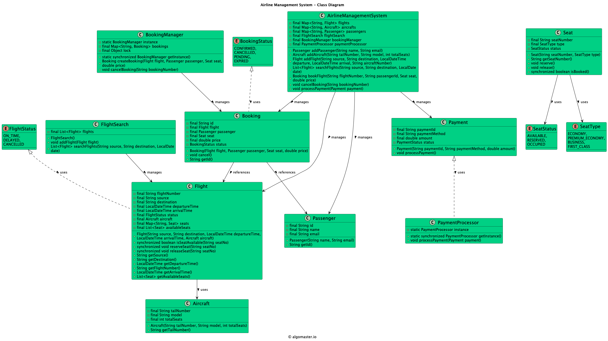

# Designing an Airline Management System

## UML Class Diagram

## Implementations
#### [Python Implementation](python/airlinemanagementsystem/)
#### [C++ Implementation](cpp/airlinemanagementsystem/)

## Classes, Interfaces and Enumerations

1. The **Flight** class represents a flight in the airline management system, with properties such as flight number, source, destination, departure time, arrival time, and available seats.
2. The **Aircraft** class represents an aircraft, with properties like tail number, model, and total seats.
3. The **Passenger** class represents a passenger, with properties such as ID, name, email, and phone number.
4. The **Booking** class represents a booking made by a passenger for a specific flight and seat, with properties such as booking number, flight, passenger, seat, price, and booking status.
5. The **Seat** class represents a seat on a flight, with properties like seat number, seat type, and seat status.
6. The **Payment** class represents a payment made for a booking, with properties such as payment ID, payment method, amount, and payment status.
7. The **FlightSearch** class provides functionality to search for flights based on source, destination, and date.
8. The **BookingManager** class manages the creation and cancellation of bookings. It follows the Singleton pattern to ensure a single instance of the booking manager.
9. The **PaymentProcessor** class handles the processing of payments. It follows the Singleton pattern to ensure a single instance of the payment processor.
10. The **AirlineManagementSystem** class serves as the main entry point of the system, combining all the components and providing methods for flight management, booking, payment processing, and other operations.
