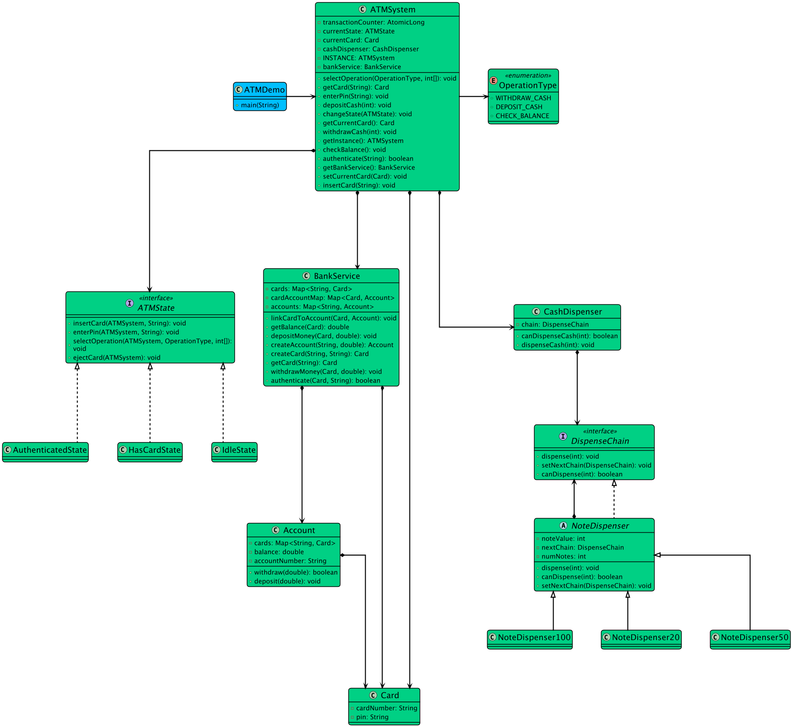

# Designing an ATM System

## UML Class Diagram

## Implementations
#### [Python Implementation](python/atm/)
#### [C++ Implementation](cpp/atm/)

## Classes, Interfaces and Enumerations
1. The **Card** class represents an ATM card with a card number and PIN.
2. The **Account** class represents a bank account with an account number and balance. It provides methods to debit and credit the account balance.
3. The **Transaction** class is an abstract base class for different types of transactions, such as withdrawal and deposit. It is extended by WithdrawalTransaction and DepositTransaction classes.
4. The **BankingService** class manages the bank accounts and processes transactions. It uses a thread-safe ConcurrentHashMap to store and retrieve account information.
5. The **CashDispenser** class represents the ATM's cash dispenser and handles the dispensing of cash. It uses synchronization to ensure thread safety when dispensing cash.
6. The **ATM** class serves as the main interface for ATM operations. It interacts with the BankingService and CashDispenser to perform user authentication, balance inquiry, cash withdrawal, and cash deposit.
7. The **ATMDriver** class demonstrates the usage of the ATM system by creating sample accounts and performing ATM operations.
