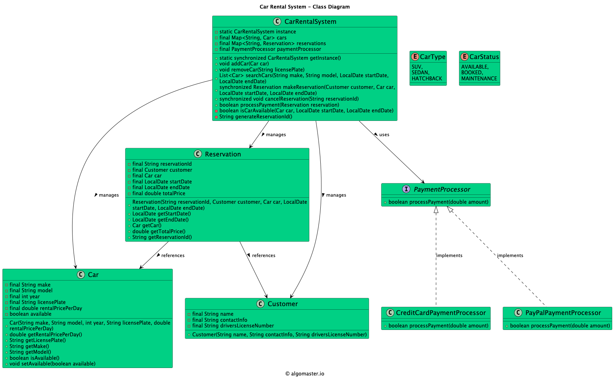

# Designing a Car Rental System

## UML Class Diagram

## Implementations
#### [Python Implementation](python/carrentalsystem/)
#### [C++ Implementation](cpp/carrentalsystem/)

## Classes, Interfaces and Enumerations
1. The **Car** class represents a car in the rental system, with properties such as make, model, year, license plate number, rental price per day, and availability status.
2. The **Customer** class represents a customer, with properties like name, contact information, and driver's license number.
3. The **Reservation** class represents a reservation made by a customer for a specific car and date range. It includes properties such as reservation ID, customer, car, start date, end date, and total price.
4. The **PaymentProcessor** interface defines the contract for payment processing, and the CreditCardPaymentProcessor and PayPalPaymentProcessor classes are concrete implementations of the payment processor.
5. The **RentalSystem** class is the core of the car rental system and follows the Singleton pattern to ensure a single instance of the rental system.
6. The RentalSystem class uses concurrent data structures (ConcurrentHashMap) to handle concurrent access to cars and reservations.
7. The **RentalSystem** class provides methods for adding and removing cars, searching for available cars based on criteria, making reservations, canceling reservations, and processing payments.
8. The **CarRentalSystem** class serves as the entry point of the application and demonstrates the usage of the car rental system.
