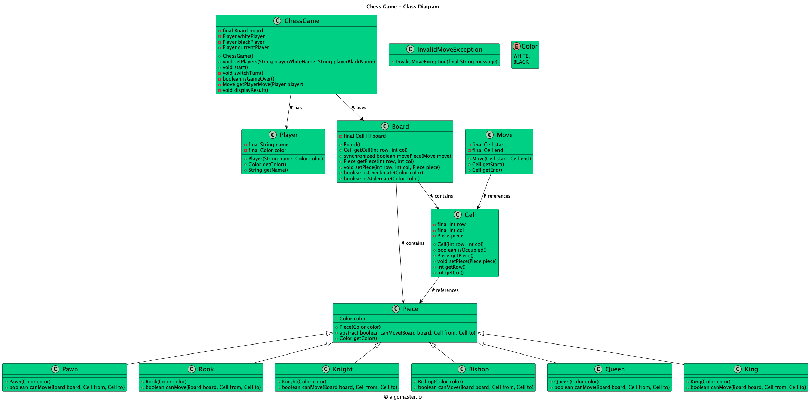

# Designing a Chess Game

## UML Class Diagram

## Implementations
#### [Python Implementation](python/chessgame/)
#### [C++ Implementation](cpp/chessgame/)

## Classes, Interfaces and Enumerations
1. The **Piece** class is an abstract base class representing a chess piece. It contains common attributes such as color, row, and column, and declares an abstract method canMove to be implemented by each specific piece class.
2. The **King**, **Queen**, **Rook**, **Bishop**, **Knight**, and **Pawn** classes extend the Piece class and implement their respective movement logic in the canMove method.
3. The **Board** class represents the chess board and manages the placement of pieces. It provides methods to get and set pieces on the board, check the validity of moves, and determine checkmate and stalemate conditions.
4. The **Player** class represents a player in the game and has a method to make a move on the board.
5. The Move class represents a move made by a player, containing the piece being moved and the destination coordinates.
6. The **Game** class orchestrates the overall game flow. It initializes the board, handles player turns, and determines the game result.
7. The **ChessGame** class is the entry point of the application and starts the game.
