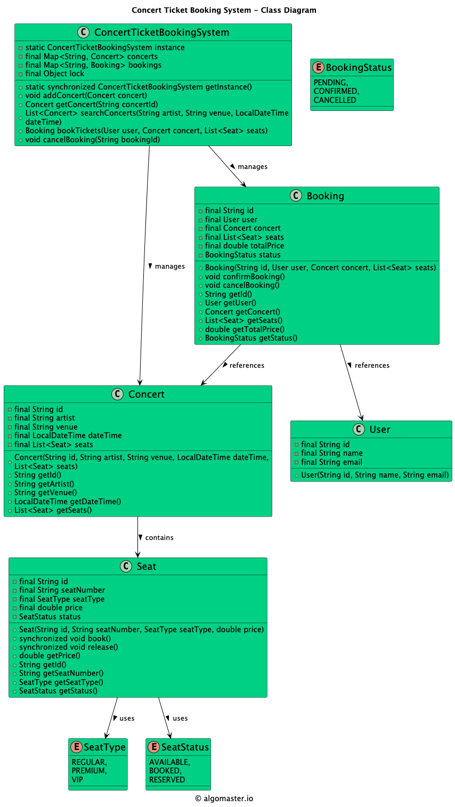

# Designing a Concert Ticket Booking System

## UML Class Diagram

## Implementations
#### [Python Implementation](python/concertticketbookingsystem/)
#### [C++ Implementation](cpp/concertticketbookingsystem/)

## Classes, Interfaces and Enumerations
1. The **Concert** class represents a concert event, with properties such as ID, artist, venue, date and time, and a list of seats.
2. The **Seat** class represents a seat in a concert, with properties like ID, seat number, seat type, price, and status. It provides methods to book and release a seat.
3. The **SeatType** enum represents the different types of seats available, such as regular, premium, and VIP.
4. The **SeatStatus** enum represents the status of a seat, which can be available, booked, or reserved.
5. The **Booking** class represents a booking made by a user for a specific concert and seats. It contains properties such as ID, user, concert, seats, total price, and status. It provides methods to confirm and cancel a booking.
6. The **BookingStatus** enum represents the status of a booking, which can be pending, confirmed, or cancelled.
7. The **User** class represents a user of the concert ticket booking system, with properties like ID, name, and email.
8. The **ConcertTicketBookingSystem** class is the central component of the system. It follows the Singleton pattern to ensure a single instance of the system. It manages concerts, bookings, and provides methods to add concerts, search concerts, book tickets, and cancel bookings.
9. The **SeatNotAvailableException** is a custom exception used to handle cases where a seat is not available for booking.
