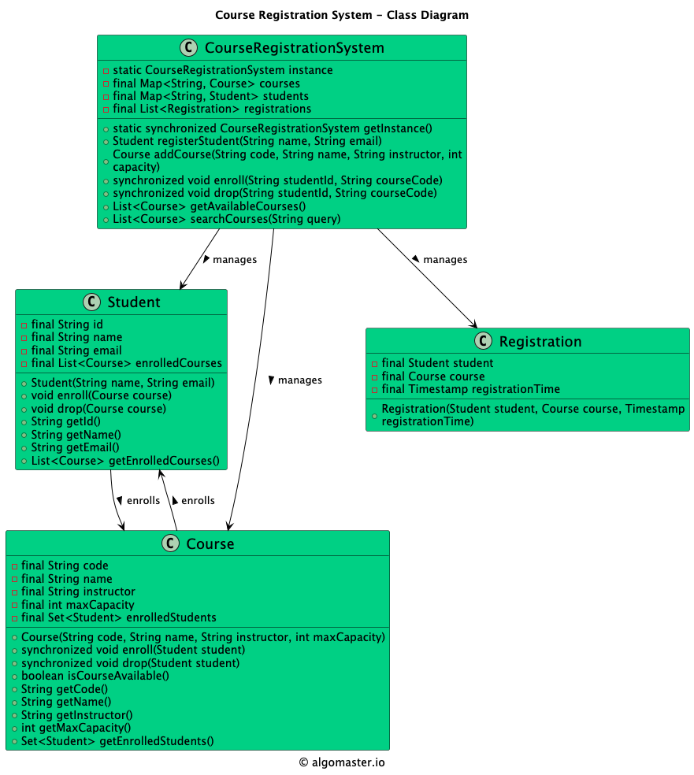

# Designing a University Course Registration System

## UML Class Diagram

## Implementations
#### [Python Implementation](python/courseregistrationsystem/)
#### [C++ Implementation](cpp/courseregistrationsystem/)

## Classes, Interfaces and Enumerations
1. The **Student** class represents a student in the course registration system, with properties such as ID, name, email, and a list of registered courses.
2. The **Course** class represents a course offered in the system, with properties such as code, name, instructor, maximum capacity, and the number of enrolled students.
3. The **Registration** class represents a registration record, associating a student with a course and capturing the registration timestamp.
4. The **CourseRegistrationSystem** class is the main class that manages the course registration system. It follows the Singleton pattern to ensure only one instance of the system exists.
5. The CourseRegistrationSystem class provides methods for adding courses and students, searching for courses, registering students for courses, and retrieving registered courses for a student.
6. Multi-threading is implemented using concurrent data structures (ConcurrentHashMap and CopyOnWriteArrayList) to handle concurrent access to shared data, such as courses and registrations.
7. The registerCourse method is synchronized to ensure thread safety when multiple students are registering for courses simultaneously.
8. The notifyObservers method is a placeholder for notifying observers (e.g., UI components) about updates to course enrollment.
9. The **CourseRegistrationDemo** class demonstrates the usage of the course registration system by creating courses and students, searching for courses, registering students for courses, and retrieving registered courses for a student.
