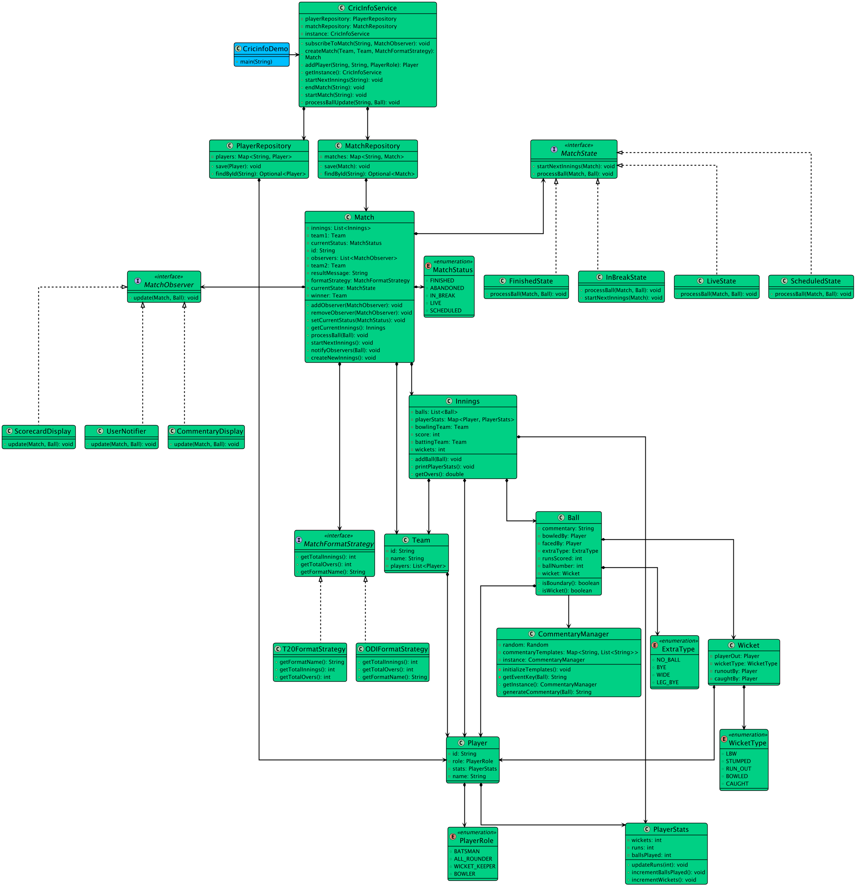

# Designing a Cricket Information System like CricInfo

## UML Class Diagram

## Implementations
#### [Python Implementation](python/cricinfo/)
#### [C++ Implementation](cpp/cricinfo/)

## Classes, Interfaces and Enumerations
1. The **Match** class represents a cricket match, with properties such as ID, title, venue, start time, teams, status, and scorecard.
2. The **Team** class represents a cricket team, with properties like ID, name, and a list of players.
3. The **Player** class represents a cricket player, with properties such as ID, name, and role.
4. The **Scorecard** class represents the scorecard of a match, containing team scores and a list of innings.
5. The **Innings** class represents an innings in a match, with properties like ID, batting team, bowling team, and a list of overs.
6. The **Over** class represents an over in an innings, containing a list of balls.
7. The **Ball** class represents a ball bowled in an over, with properties such as ball number, bowler, batsman, and result.
8. The **MatchStatus** enum represents the different statuses of a match, such as scheduled, in progress, completed, or abandoned.
9. The **MatchService** class manages the matches in the system, providing methods to add, retrieve, and update match information. It follows the Singleton pattern to ensure a single instance of the service.
10. The **ScorecardService** class manages the scorecards of matches, allowing the creation, retrieval, and update of scorecards and their associated data, such as innings and scores. It also follows the Singleton pattern.
11. The **CricinfoSystem** class serves as the main entry point of the system, integrating the match and scorecard services and providing high-level methods for interacting with the system.
