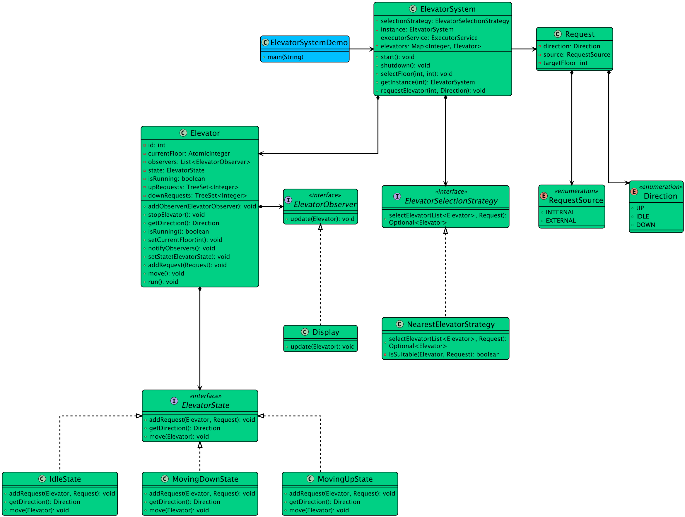

# Designing an Elevator System

## UML Class Diagram

## Implementations
#### [Python Implementation](python/elevatorsystem/)
#### [C++ Implementation](cpp/elevatorsystem/)

## Classes, Interfaces and Enumerations
1. The **Direction** enum represents the possible directions of elevator movement (UP or DOWN).
2. The **Request** class represents a user request for an elevator, containing the source floor and destination floor.
3. The **Elevator** class represents an individual elevator in the system. It has a capacity limit and maintains a list of 4. requests. The elevator processes requests concurrently and moves between floors based on the requests.
4. The **ElevatorController** class manages multiple elevators and handles user requests. It finds the optimal elevator to serve a request based on the proximity of the elevators to the requested floor.
5. The **ElevatorSystem** class is the entry point of the application and demonstrates the usage of the elevator system.
