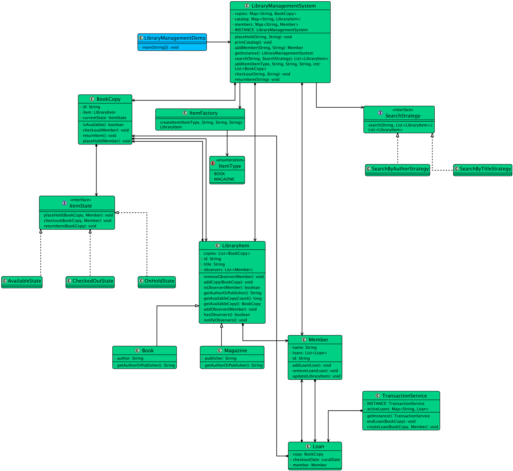

# Designing a Library Management System

## UML Class Diagram

## Implementations
#### [Python Implementation](python/librarymanagementsystem/)
#### [C++ Implementation](cpp/librarymanagementsystem/)

## Classes, Interfaces and Enumerations
1. The **Book** class represents a book in the library catalog, with properties such as ISBN, title, author, publication year, and availability status.
2. The **Member** class represents a library member, with properties like member ID, name, contact information, and a list of borrowed books.
3. The **LibraryManager** class is the core of the library management system and follows the Singleton pattern to ensure a single instance of the library manager.
4. The LibraryManager class uses concurrent data structures (ConcurrentHashMap) to handle concurrent access to the library catalog and member records.
5. The LibraryManager class provides methods for adding and removing books, registering and unregistering members, borrowing and returning books, and searching for books based on keywords.
6. The **LibraryManagementSystemDemo** class serves as the entry point of the application and demonstrates the usage of the library management system.
