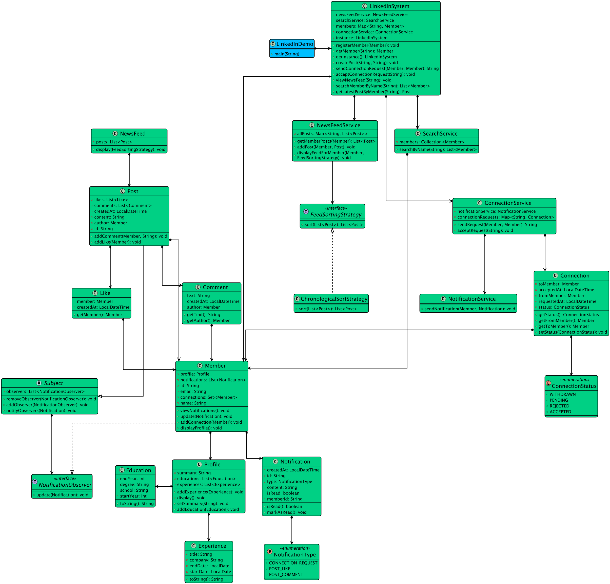

# Designing a Professional Networking Platform like LinkedIn

## UML Class Diagram

## Implementations
#### [Python Implementation](python/linkedin/)
#### [C++ Implementation](cpp/linkedin/)

## Classes, Interfaces and Enumerations
1. The **User** class represents a user in the LinkedIn system, containing properties such as ID, name, email, password, profile, connections, inbox, and sent messages.
2. The **Profile** class represents a user's profile, containing properties such as profile picture, headline, summary, experiences, educations, and skills.
3. The **Experience**, **Education**, and **Skill** classes represent different components of a user's profile.
4. The **Connection** class represents a connection between two users, containing the user and the connection date.
5. The **Message** class represents a message sent between users, containing properties such as ID, sender, receiver, content, and timestamp.
6. The **JobPosting** class represents a job listing posted by an employer, containing properties such as ID, title, description, requirements, location, and post date.
7. The **Notification** class represents a notification generated for a user, containing properties such as ID, user, notification type, content, and timestamp.
8. The **NotificationType** enum defines the different types of notifications, such as connection request, message, and job posting.
9. The **LinkedInService** class is the main class that manages the LinkedIn system. It follows the Singleton pattern to ensure only one instance of the service exists.
10. The **LinkedInService** class provides methods for user registration, login, profile updates, connection requests, job postings, user and job search, messaging, and notifications.
11. Multi-threading is achieved using concurrent data structures such as ConcurrentHashMap and CopyOnWriteArrayList to handle concurrent access to shared resources.
12. The **LinkedInDemo** class demonstrates the usage of the LinkedIn system by registering users, logging in, updating profiles, sending connection requests, posting job listings, searching for users and jobs, sending messages, and retrieving notifications.
