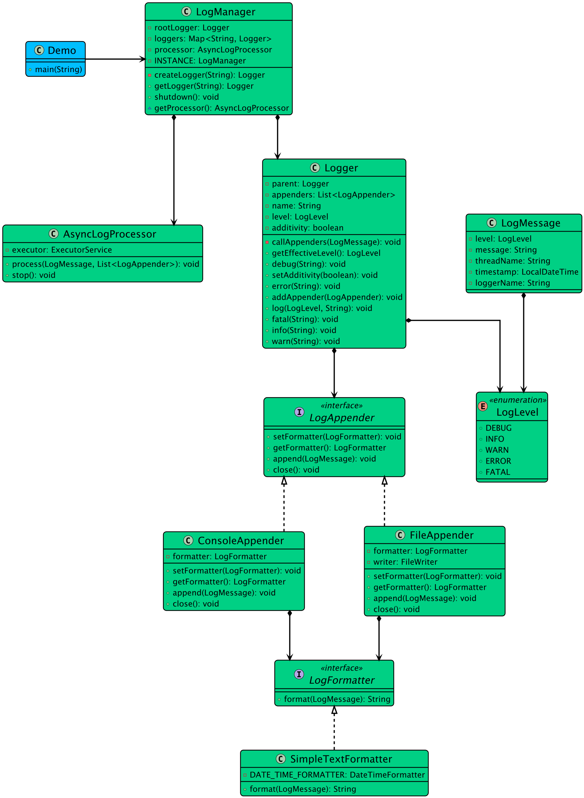

# Designing a Logging Framework

## UML Class Diagram

## Implementations
#### [Python Implementation](python/loggingframework/)
#### [C++ Implementation](cpp/loggingframework/)

## Classes, Interfaces and Enumerations
1. The **LogLevel** enum defines the different log levels supported by the logging framework.
2. The **LogMessage** class represents a log message with a timestamp, log level, and message content.
3. The **LogAppender** interface defines the contract for appending log messages to different output destinations.
4. The **ConsoleAppender**, **FileAppender**, and **DatabaseAppender** classes are concrete implementations of the LogAppender interface, supporting logging to the console, file, and database, respectively.
5. The **LoggerConfig** class holds the configuration settings for the logger, including the log level and the selected log appender.
6. The **Logger** class is a singleton that provides the main logging functionality. It allows setting the configuration, logging messages at different levels, and provides convenience methods for each log level.
7. The **LoggingExample** class demonstrates the usage of the logging framework, showcasing different log levels, changing the configuration, and logging from multiple threads.
