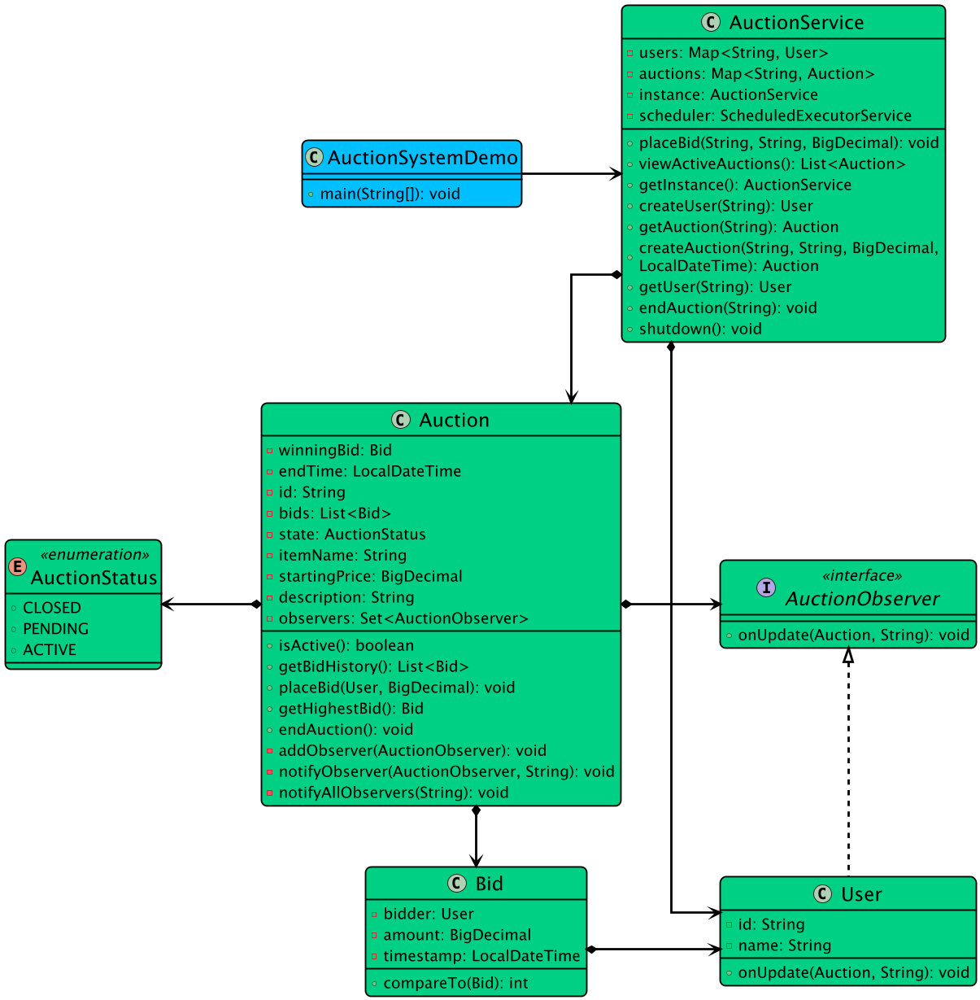

# Designing an Online Auction System

## UML Class Diagram

## Implementations
#### [Python Implementation](python/onlineauctionsystem/)
#### [C++ Implementation](cpp/onlineauctionsystem/)

## Classes, Interfaces and Enumerations
1. The **User** class represents a user in the online auction system, with properties such as id, username, and email.
2. The **AuctionStatus** enum defines the possible states of an auction listing, such as active and closed.
3. The **AuctionListing** class represents an auction listing in the system, with properties like id, item name, description, starting price, duration, seller, current highest bid, and a list of bids.
4. The **Bid** class represents a bid placed by a user on an auction listing, with properties such as id, bidder, amount, and timestamp.
5. The **AuctionSystem** class is the core of the online auction system and follows the Singleton pattern to ensure a single instance of the auction system.
6. The AuctionSystem class uses concurrent data structures (ConcurrentHashMap and CopyOnWriteArrayList) to handle concurrent access to auction listings and ensure thread safety.
7. The AuctionSystem class provides methods for registering users, creating auction listings, searching auction listings, and placing bids.
8. The **AuctionSystemDemo** class serves as the entry point of the application and demonstrates the usage of the online auction system.
