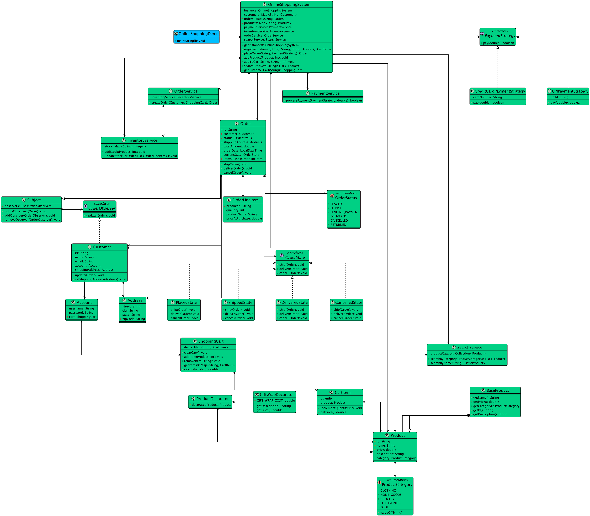

# Designing an Online Shopping System Like Amazon

## UML Class Diagram

## Implementations
#### [Python Implementation](python/onlineshoppingservice/)
#### [C++ Implementation](cpp/onlineshoppingservice/)

## Classes, Interfaces and Enumerations
1. The **User** class represents a user in the online shopping service, with properties such as ID, name, email, password, and a list of orders.
2. The **Product** class represents a product available for purchase, with properties like ID, name, description, price, and quantity. It provides methods to update the quantity and check product availability.
3. The **Order** class represents an order placed by a user, containing properties such as ID, user, order items, total amount, and order status. It calculates the total amount based on the order items.
4. The **OrderItem** class represents an item within an order, consisting of the product and the quantity ordered.
5. The **OrderStatus** enum represents the different statuses an order can have, such as pending, processing, shipped, delivered, or cancelled.
6. The **ShoppingCart** class represents the user's shopping cart, allowing them to add, remove, and update item quantities. It maintains a map of product IDs and order items.
7. The **Payment** interface defines the contract for processing payments, with a concrete implementation CreditCardPayment.
8. The **OnlineShoppingService** class is the central component of the online shopping service. It follows the Singleton pattern to ensure only one instance of the service exists. It provides methods to register users, add products, search products, place orders, and retrieve order information. It handles concurrent access to shared resources using synchronization.
9. The **OnlineShoppingServiceDemo** class demonstrates the usage of the online shopping service by registering users, adding products, searching for products, placing orders, and viewing order history.
