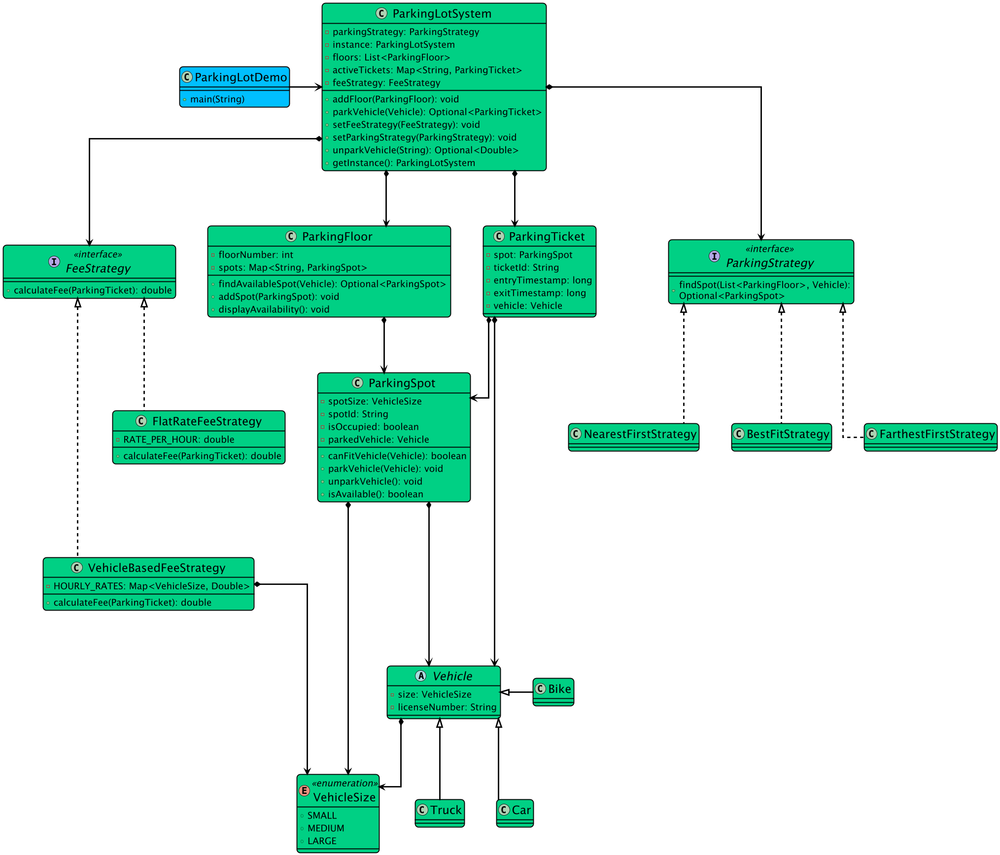

# Designing a Parking Lot System

## UML Class Diagram

## Implementations
#### [Python Implementation](python/parkinglot/)
#### [C++ Implementation](cpp/parkinglot/)

## Classes, Interfaces and Enumerations
1. The **ParkingLot** class follows the Singleton pattern to ensure only one instance of the parking lot exists. It maintains a list of levels and provides methods to park and unpark vehicles.
2. The **ParkingFloor** class represents a level in the parking lot and contains a list of parking spots. It handles parking and unparking of vehicles within the level.
3. The **ParkingSpot** class represents an individual parking spot and tracks the availability and the parked vehicle.
4. The **Vehicle** class is an abstract base class for different types of vehicles. It is extended by Car, Motorcycle, and Truck classes.
5. The **VehicleSize** enum defines the different types of vehicles supported by the parking lot.
6. Multi-threading is achieved through the use of synchronized keyword on critical sections to ensure thread safety.
7. The **Main** class demonstrates the usage of the parking lot system.

## Design Patterns Used:
1. Singleton Pattern: Ensures only one instance of the ParkingLot class.
2. Factory Pattern (optional extension): Could be used for creating vehicles based on input.
3. Observer Pattern (optional extension): Could notify customers about available spots.
