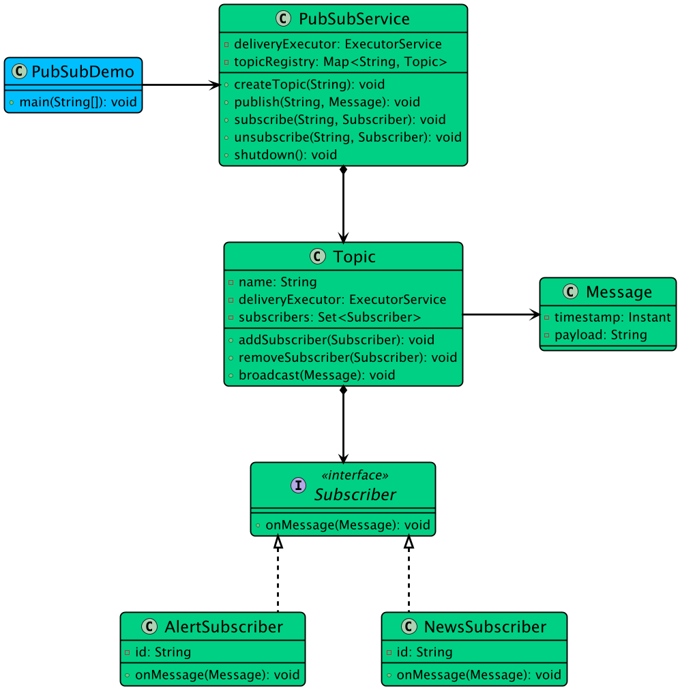

# Designing a Pub-Sub System in Java

## UML Class Diagram

## Implementations
#### [Python Implementation](python/pubsubsystem/)
#### [C++ Implementation](cpp/pubsubsystem/)

## Classes, Interfaces and Enumerations
1. The **Message** class represents a message that can be published and received by subscribers. It contains the message content.
2. The **Topic** class represents a topic to which messages can be published. It maintains a set of subscribers and provides methods to add and remove subscribers, as well as publish messages to all subscribers.
3. The **Subscriber** interface defines the contract for subscribers. It declares the onMessage method that is invoked when a subscriber receives a message.
4. The **PrintSubscriber** class is a concrete implementation of the Subscriber interface. It receives messages and prints them to the console.
5. The **Publisher** class represents a publisher that publishes messages to a specific topic.
6. The **PubSubSystem** class is the main class that manages topics, subscribers, and message publishing. It uses a ConcurrentHashMap to store topics and an ExecutorService to handle concurrent message publishing.
7. The **PubSubDemo** class demonstrates the usage of the Pub-Sub system by creating topics, subscribers, and publishers, and publishing messages.
