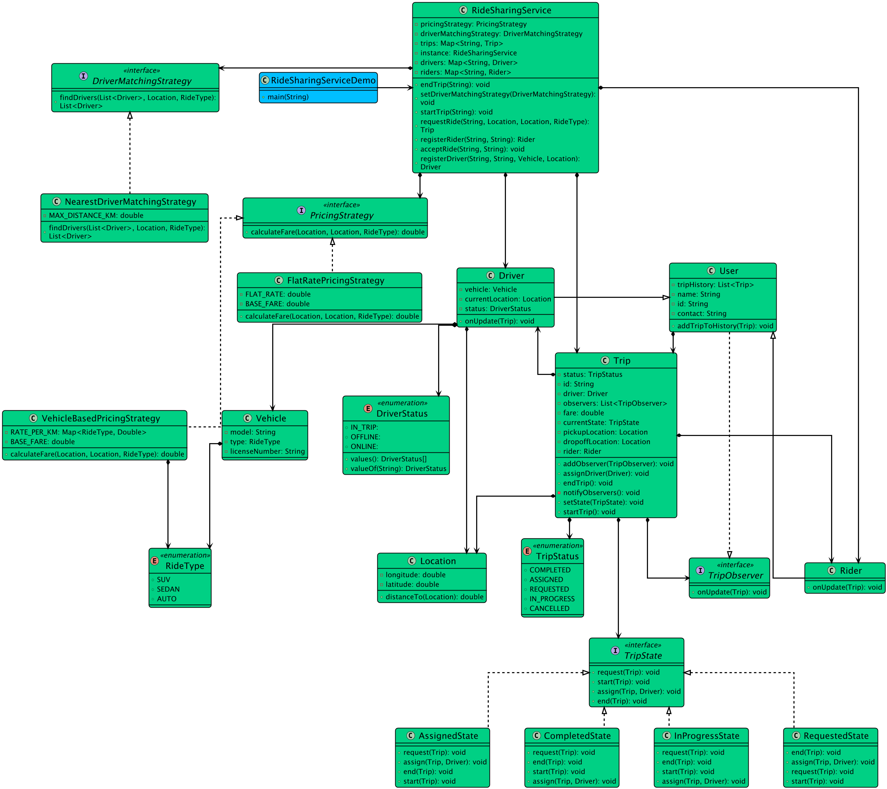

# Designing a Ride-Sharing Service Like Uber

## UML Class Diagram

## Implementations
#### [Python Implementation](python/ridesharingservice/)
#### [C++ Implementation](cpp/ridesharingservice/)

## Classes, Interfaces and Enumerations
1. The **Passenger** class represents a passenger in the ride sharing service, with properties such as ID, name, contact information, and location.
2. The **Driver** class represents a driver in the ride sharing service, with properties such as ID, name, contact information, license plate, location, and status (available or busy).
3. The **Ride** class represents a ride requested by a passenger and accepted by a driver, with properties such as ID, passenger, driver, source location, destination location, status, and fare.
4. The **Location** class represents a geographical location with latitude and longitude coordinates.
5. The **Payment** class represents a payment made for a ride, with properties such as ID, ride, amount, and payment status.
6. The **RideService** class is the main class that manages the ride sharing service. It follows the Singleton pattern to ensure only one instance of the service exists.
7. The RideService class provides methods for adding passengers and drivers, requesting rides, accepting rides, starting rides, completing rides, and canceling rides.
8. Multi-threading is implemented using concurrent data structures (ConcurrentHashMap and ConcurrentLinkedQueue) to handle concurrent access to shared data, such as ride requests and driver availability.
9. The notifyDrivers, notifyPassenger, and notifyDriver methods are placeholders for notifying relevant parties about ride status updates.
10. The calculateFare and processPayment methods are placeholders for calculating ride fares and processing payments, respectively.
11. The **RideSharingDemo** class demonstrates the usage of the ride sharing service by creating passengers and drivers, requesting rides, accepting rides, starting rides, completing rides, and canceling rides.
