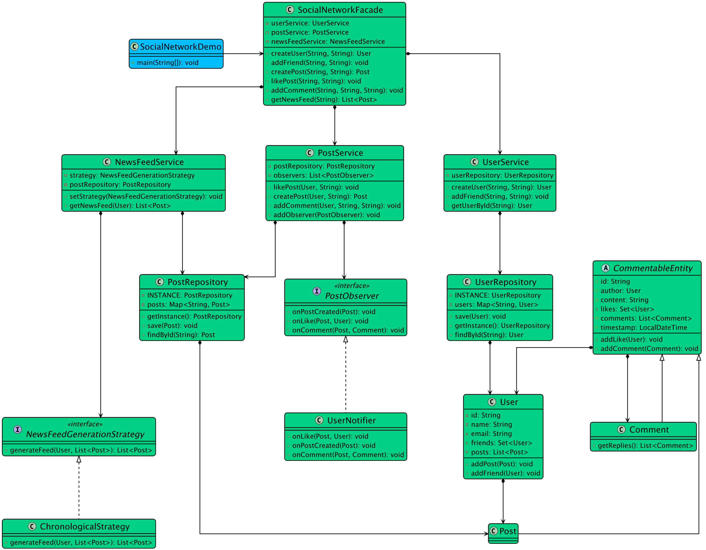

# Designing a Social Network Like Facebook

## UML Class Diagram

## Implementations
#### [Python Implementation](python/socialnetworkingservice/)
#### [C++ Implementation](cpp/socialnetworkingservice/)

## Classes, Interfaces and Enumerations
1. The **User** class represents a user in the social networking system, containing properties such as ID, name, email, password, profile picture, bio, list of friends, and list of posts.
2. The **Post** class represents a post created by a user, containing properties such as ID, user ID, content, image URLs, video URLs, timestamp, likes, and comments.
3. The **Comment** class represents a comment made by a user on a post, containing properties such as ID, user ID, post ID, content, and timestamp.
4. The **Notification** class represents a notification generated for a user, containing properties such as ID, user ID, notification type, content, and timestamp.
5. The **NotificationType** enum defines the different types of notifications, such as friend request, friend request accepted, like, comment, and mention.
6. The **SocialNetworkingService** class is the main class that manages the social networking system. It follows the Singleton pattern to ensure only one instance of the service exists.
7. The SocialNetworkingService class provides methods for user registration, login, profile updates, friend requests, post creation, newsfeed generation, likes, comments, and notifications.
8. Multi-threading is achieved using concurrent data structures such as ConcurrentHashMap and CopyOnWriteArrayList to handle concurrent access to shared resources.
9. The **SocialNetworkingDemo** class demonstrates the usage of the social networking system by registering users, logging in, sending friend requests, creating posts, liking posts, commenting on posts, and retrieving newsfeed and notifications.
