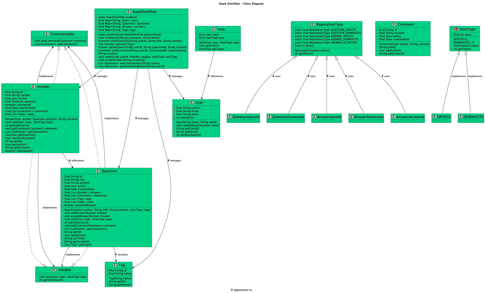

# Designing Stack Overflow

## UML Class Diagram

## Implementations
#### [Python Implementation](python/stackoverflow/)
#### [C++ Implementation](cpp/stackoverflow/)

## Classes, Interfaces and Enumerations
1. The **User** class represents a user of the Stack Overflow system, with properties such as id, username, email, and reputation.
2. The **Question** class represents a question posted by a user, with properties such as id, title, content, author, answers, comments, tags, votes and creation date.
3. The **Answer** class represents an answer to a question, with properties such as id, content, author, associated question, comments, votes and creation date.
4. The **Comment** class represents a comment on a question or an answer, with properties such as id, content, author, and creation date.
5. The **Tag** class represents a tag associated with a question, with properties such as id and name.
6. The **Vote** class represents vote associated with a question/answer.
7. The **StackOverflow** class is the main class that manages the Stack Overflow system. It provides methods for creating user, posting questions, answers, and comments, voting on questions and answers, searching for questions, and retrieving questions by tags and users.
8.  The **StackOverflowDemo** class demonstrates the usage of the Stack Overflow system by creating users, posting questions and answers, voting, searching for questions, and retrieving questions by tags and users.
