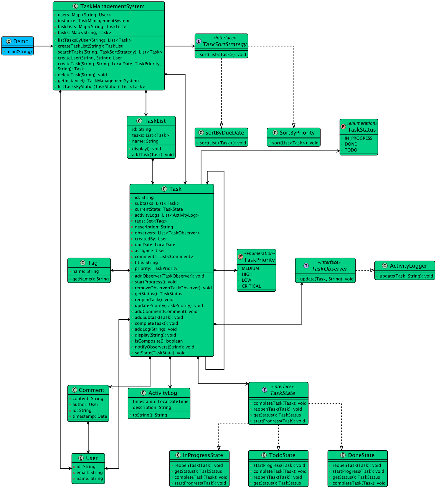

# Designing a Task Management System

## UML Class Diagram

## Implementations
#### [Python Implementation](python/taskmanagementsystem/)
#### [C++ Implementation](cpp/taskmanagementsystem/)

## Classes, Interfaces and Enumerations
1. The **User** class represents a user in the task management system, with properties such as id, name, and email.
2. The **TaskStatus** enum defines the possible states of a task, such as pending, in progress, and completed.
3. The **Task** class represents a task in the system, with properties like id, title, description, due date, priority, status, and assigned user.
4. The **TaskManager** class is the core of the task management system and follows the Singleton pattern to ensure a single instance of the task manager.
5. The TaskManager class uses concurrent data structures (ConcurrentHashMap and CopyOnWriteArrayList) to handle concurrent access to tasks and ensure thread safety.
6. The TaskManager class provides methods for creating, updating, deleting, searching, and filtering tasks, as well as marking tasks as completed and retrieving task history for a user.
7. The **TaskManagementSystem** class serves as the entry point of the application and demonstrates the usage of the task management system.
