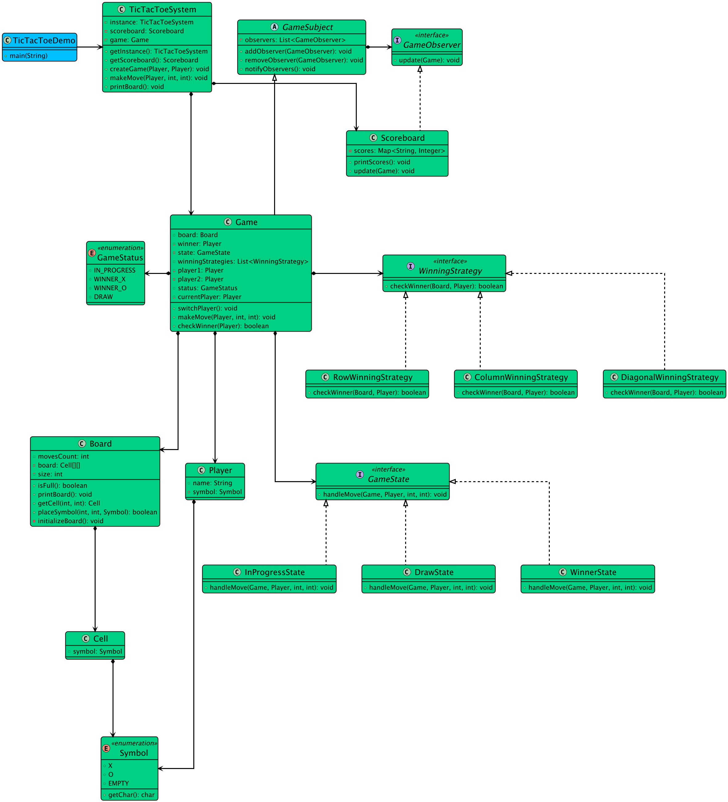

# Designing a Tic Tac Toe Game

## UML Class Diagram

## Implementations
#### [Python Implementation](python/tictactoe/)
#### [C++ Implementation](cpp/tictactoe/)

## Classes, Interfaces and Enumerations
1. The **Player** class represents a player in the game, with a name and a symbol (X or O).
2. The **Board** class represents the game board, which is a 3x3 grid. It provides methods to make moves, check for a winner, and check if the board is full.
3. The **Game** class manages the game flow and player interactions. It handles player turns, validates moves, and determines the winner or a draw.
4. The **TicTacToe** class is the entry point of the application and creates instances of the players and the game.
