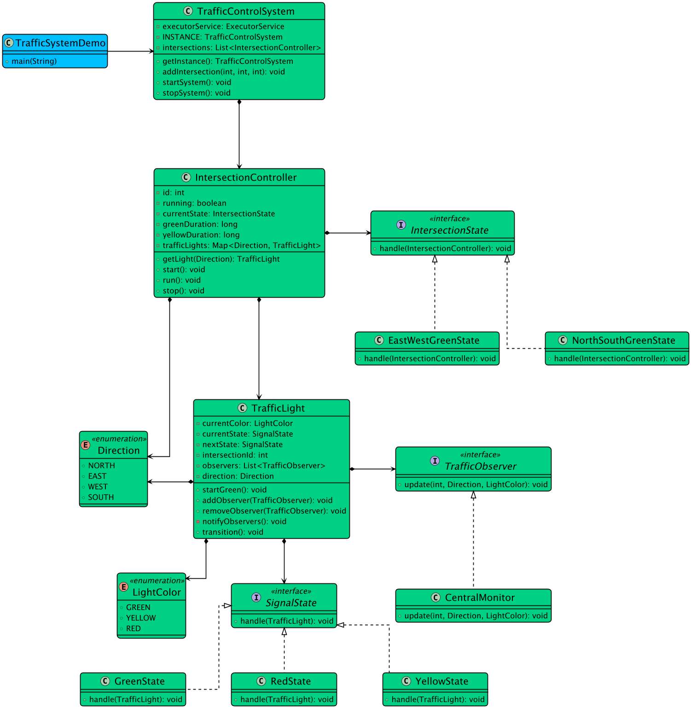

# Designing a Traffic Signal Control System

## UML Class Diagram

## Implementations
#### [Python Implementation](python/trafficsignalsystem/)
#### [C++ Implementation](cpp/trafficsignalsystem/)

## Classes, Interfaces and Enumerations
1. The **Signal** enum represents the different states of a traffic light: red, yellow, and green.
2. The **Road** class represents a road in the traffic signal system, with properties such as ID, name, and an associated traffic light.
3. The **TrafficLight** class represents a traffic light, with properties such as ID, current signal, and durations for each signal state. It provides methods to change the signal and notify observers (e.g., roads) about signal changes.
4. The **TrafficController** class serves as the central controller for the traffic signal system. It follows the Singleton pattern to ensure a single instance of the controller. It manages the roads and their associated traffic lights, starts the traffic control process, and handles emergency situations.
5. The **TrafficSignalSystemDemo** class is the main entry point of the application. It demonstrates the usage of the traffic signal system by creating roads, traffic lights, assigning traffic lights to roads, and starting the traffic control process.
