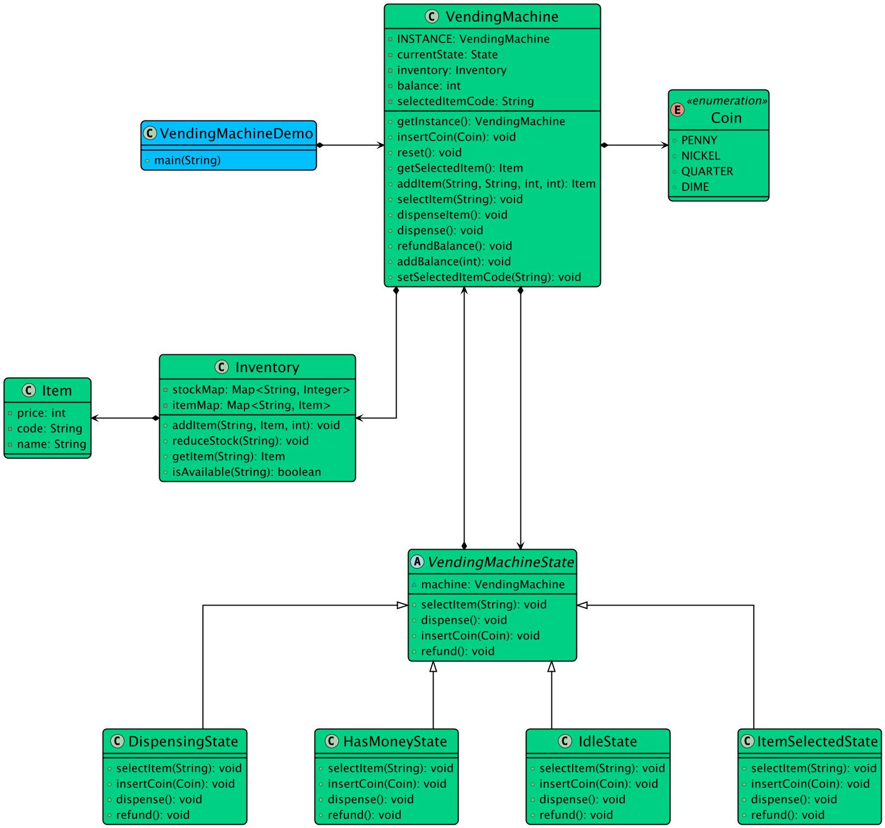

# Designing a Vending Machine

## UML Class Diagram

## Implementations
#### [Python Implementation](python/vendingmachine/)
#### [C++ Implementation](cpp/vendingmachine/)

## Classes, Interfaces and Enumerations
1. The **Product** class represents a product in the vending machine, with properties such as name and price.
2. The **Coin** and **Note** enums represent the different denominations of coins and notes accepted by the vending machine.
3. The **Inventory** class manages the available products and their quantities in the vending machine. It uses a concurrent hash map to ensure thread safety.
4. The **VendingMachineState** interface defines the behavior of the vending machine in different states, such as idle, ready, and dispense.
5. The **IdleState**, **ReadyState**, and **DispenseState** classes implement the VendingMachineState interface and define the specific behaviors for each state.
6. The **VendingMachine** class is the main class that represents the vending machine. It follows the Singleton pattern to ensure only one instance of the vending machine exists.
7. The VendingMachine class maintains the current state, selected product, total payment, and provides methods for state transitions and payment handling.
8. The **VendingMachineDemo** class demonstrates the usage of the vending machine by adding products to the inventory, selecting products, inserting coins and notes, dispensing products, and returning change.
